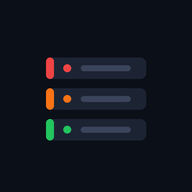
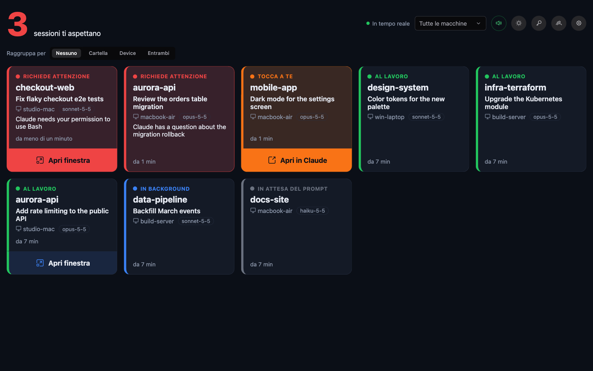
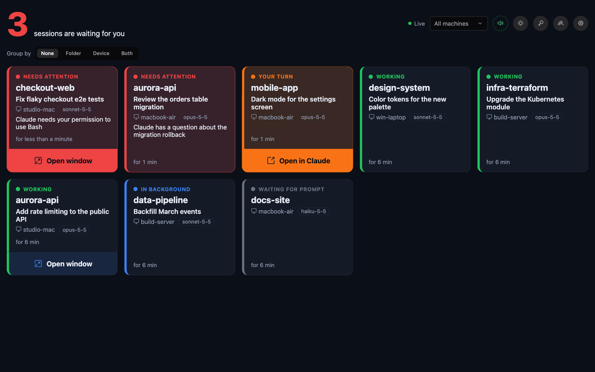
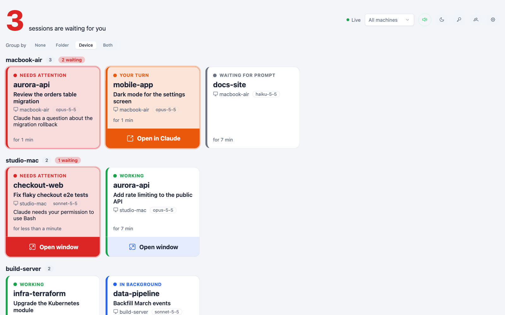
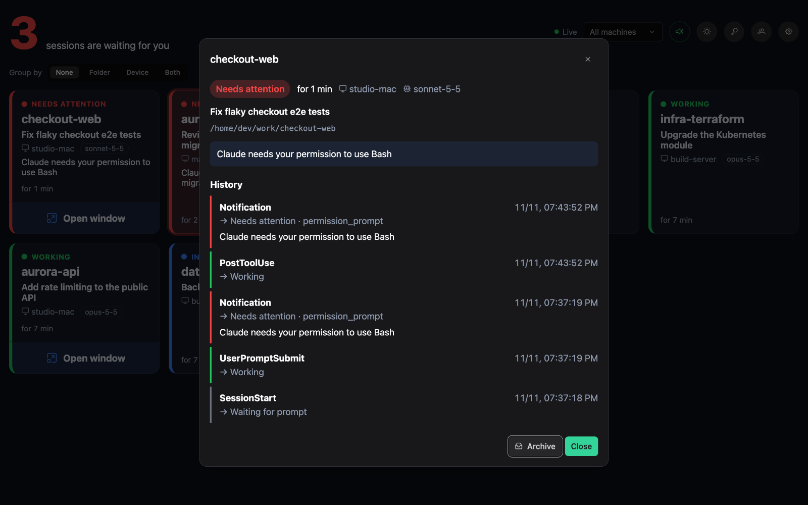
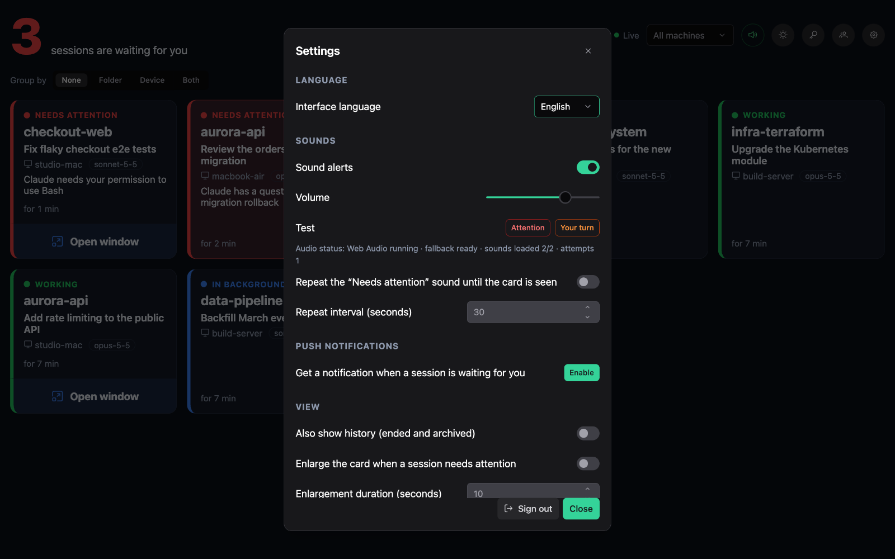
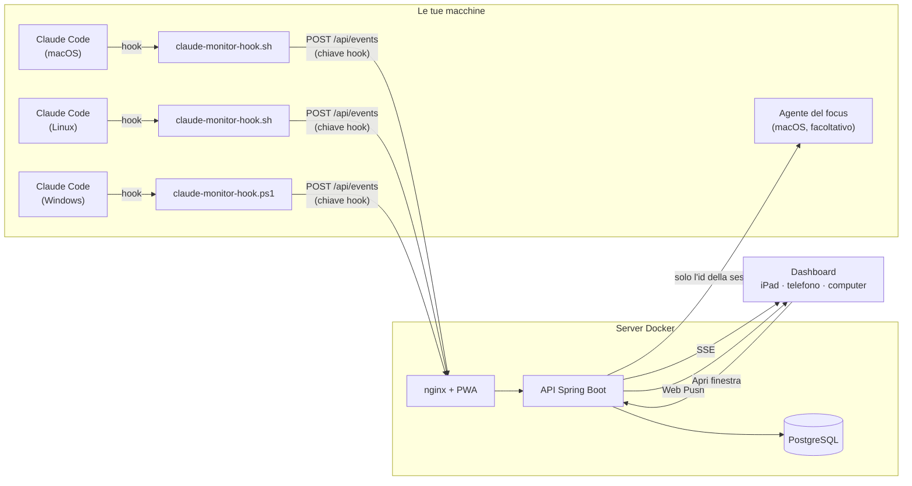

<div align="center">



# Claude Monitor

**Una dashboard in tempo reale, da ospitare in proprio, per tutte le tue sessioni Claude Code, su ogni macchina.**<br />
Vedi a colpo d'occhio quale sessione aspetta un permesso, quale aspetta la tua risposta e quali stanno ancora
lavorando, con avvisi sonori e notifiche push su iPad, telefono o computer.

[](https://github.com/sartoriadelcodice/claude-monitor/actions/workflows/ci.yml)
[](LICENSE)
[](backend/pom.xml)
[](frontend/package.json)
[](#installazione-su-ipad-e-iphone)

[Sito](https://sartoriadelcodice.github.io/claude-monitor/it/) ·
[Avvio rapido](#avvio-rapido) ·
[Guida all'uso](docs/user-guide.it.md) ·
[Hook](hooks/README.md) ·
[Contribuire](CONTRIBUTING.md) ·
[🇬🇧 English](README.md)



</div>

## Perché Claude Monitor

Chi usa Claude Code in più terminali, magari su più computer, passa il tempo a controllare le finestre per capire
quale sessione è ferma su una richiesta di permesso e quale ha finito e aspetta te. Claude Monitor raccoglie gli
eventi degli [hook](https://code.claude.com/docs/en/hooks) di ogni sessione e li trasforma in un'unica bacheca in
tempo reale: le sessioni che ti aspettano vengono per prime, restano evidenziate finché non le guardi e suonano.
Puoi tenere un iPad sulla scrivania, allontanarti dalla tastiera e tornare proprio quando Claude ha bisogno di te.

## Funzioni

- **Tutte le sessioni, tutte le macchine**: una card per sessione con stato, cartella, nome della sessione,
  macchina, modello e tempo nello stato, aggiornata in tempo reale (Server-Sent Events).
- **Prima ciò che ti aspetta**: contatore delle sessioni in attesa, card ordinate per urgenza e raggruppabili per
  cartella, device o entrambi.
- **Avvisi sonori e notifiche push**: due suoni diversi per «Richiede attenzione» e «Tocca a te», ripetizione
  facoltativa finché la card non è vista, Web Push anche con l'app chiusa.
- **Niente falsi allarmi**: le sessioni che hanno finito di rispondere ma hanno ancora task in background o
  risvegli pianificati sono «In background» e restano silenziose finché non tocca davvero a te.
- **Vai alla finestra** *(macOS, facoltativo)*: il pulsante «Apri finestra» porta in primo piano il terminale giusto
  o l'app Claude, sul Mac che stai usando; supporta il controllo remoto.
- **Riservatezza**: l'hook toglie prompt, risposte, input e output dei tool prima dell'invio e il server li scarta
  di nuovo prima di salvare. Si ospita in proprio: i dati restano sulla tua infrastruttura.
- **Più utenti**: ognuno con le proprie sessioni, chiavi hook e dispositivi; gli amministratori gestiscono gli account.
- **PWA installabile**: pensata per iPad e iPhone, funziona su ogni browser moderno, si aggiorna da sola, tema
  chiaro e scuro.
- **Italiano e inglese**: l'interfaccia segue la lingua del browser o la scelta fatta su ogni dispositivo; le
  traduzioni sono semplici file JSON.
- **Installazione degli hook con un comando**: crei una chiave nella dashboard e scarichi uno script pronto per
  macOS, Linux o Windows.

## Schermate

<table>
  <tr>
    <td width="50%"></td>
    <td width="50%"></td>
  </tr>
  <tr>
    <td align="center">Tema scuro (interfaccia in inglese)</td>
    <td align="center">Tema chiaro, card raggruppate per device</td>
  </tr>
  <tr>
    <td width="50%"></td>
    <td width="50%"></td>
  </tr>
  <tr>
    <td align="center">Dettaglio della sessione con la cronologia</td>
    <td align="center">Impostazioni: lingua, suoni, push, focus</td>
  </tr>
</table>

## Come funziona



1. Un piccolo script registrato come hook di Claude Code invia ogni evento (avvio della sessione, prompt, uso dei
   tool, notifiche, fine della risposta…) al backend, autenticandosi con una **chiave hook** personale.
2. Il backend ricava lo stato della sessione, lo salva in PostgreSQL e invia il cambiamento a ogni dashboard aperta
   (SSE) e, quando la sessione ti aspetta, ai tuoi dispositivi (Web Push).
3. La dashboard suona, evidenzia la card e, su macOS, può chiedere all'agente facoltativo di portare in primo piano
   la finestra della sessione.

### Stati di una sessione

| Stato             | Sulla card            | Significato                                                              | Avviso       |
| ----------------- | --------------------- | ------------------------------------------------------------------------ | ------------ |
| `NEEDS_ATTENTION` | Richiede attenzione   | Claude aspetta un permesso o una risposta a una domanda                  | Suono e push |
| `WAITING_INPUT`   | Tocca a te            | Risposta terminata, nessun lavoro in corso                               | Suono e push |
| `WORKING`         | Al lavoro             | Claude sta lavorando                                                     | —            |
| `BACKGROUND`      | In background         | Risposta terminata, ma con task in background o risvegli pianificati: ripartirà da sola | — |
| `IDLE`            | In attesa del prompt  | Sessione aperta, nessun prompt ancora inviato                            | —            |
| `STALE`           | Ferma                 | Nessun evento da più di `STALE_AFTER` (30 minuti se non impostato)       | —            |
| `ENDED`           | Terminata             | Sessione chiusa: esce dalla vista principale e resta nello storico       | —            |

La corrispondenza tra eventi degli hook e stati è descritta (in inglese) in
[hooks/README.md](hooks/README.md#events-and-states).

## Avvio rapido

**Requisiti:** Docker con Docker Compose e un indirizzo HTTPS per la PWA e le notifiche push (vedi [HTTPS](#https)).
Sulle macchine da monitorare: Claude Code e `curl` (`jq` è consigliato).

```bash
git clone https://github.com/sartoriadelcodice/claude-monitor.git
cd claude-monitor
cp .env.example .env
```

1. Modifica `.env`: imposta `DB_PASSWORD`, `ADMIN_PASSWORD` e `JWT_SECRET` (per un valore casuale:
   `openssl rand -hex 32`). `ADMIN_USERNAME` e `ADMIN_PASSWORD` servono solo al primo avvio, per creare
   l'amministratore iniziale.
2. Ottieni una chiave PrimeUI gratuita (Community License) da <https://primeui.dev/licenses> e mettila in
   `PRIMENG_LICENSE`. PrimeNG 22 la richiede; senza chiave la dashboard funziona ma mostra un avviso in un angolo.
3. Genera le chiavi VAPID per le notifiche push e copiale in `.env`:

   ```bash
   scripts/generate-vapid-keys.sh
   ```

4. Avvia lo stack:

   ```bash
   docker compose up -d --build
   ```

   La dashboard risponde su <http://localhost:8088> (porta configurabile con `FRONTEND_PORT`).

5. Accedi, crea una **chiave hook** (pulsante con la chiave, in alto) e scarica lo script di installazione per la
   macchina: installa l'hook e aggiorna le impostazioni globali di Claude Code, dopo averne salvato una copia.
   L'installazione manuale è descritta in [hooks/README.md](hooks/README.md).

Apri una nuova sessione di Claude Code su quella macchina: la card compare nella dashboard.

> **Vuoi solo dare un'occhiata?** `scripts/demo-events.sh http://localhost:8088 <chiave-hook> seed` riempie la
> dashboard di sessioni finte in tutti gli stati; con `live` cambiano di continuo, per sentire gli avvisi.

### Installazione su iPad e iPhone

1. Apri la dashboard in Safari tramite l'indirizzo HTTPS.
2. Condividi → «Aggiungi alla schermata Home».
3. Apri l'app dalla Home ed esegui l'accesso.
4. Tocca «Attiva suoni» e «Attiva notifiche».

Le notifiche push su iPadOS e iOS funzionano solo dall'app installata (versione 16.4 o successiva).

## Configurazione

Tutte le impostazioni sono variabili d'ambiente, lette da `.env` tramite Docker Compose
(vedi [.env.example](.env.example)).

| Variabile                     | Predefinito               | Descrizione                                                        |
| ----------------------------- | ------------------------- | ------------------------------------------------------------------ |
| `DB_PASSWORD`                 | —                         | Password di PostgreSQL (obbligatoria)                              |
| `ADMIN_USERNAME`              | `admin`                   | Amministratore iniziale, creato solo se non esistono utenti        |
| `ADMIN_PASSWORD`              | —                         | Password dell'amministratore iniziale (obbligatoria)               |
| `JWT_SECRET`                  | —                         | Segreto che firma i login, almeno 32 caratteri (obbligatorio)      |
| `JWT_TTL`                     | `30d`                     | Durata di un login                                                 |
| `STALE_AFTER`                 | `30m`                     | Tempo senza eventi dopo cui una sessione diventa «Ferma»           |
| `VAPID_PUBLIC_KEY`            | —                         | Chiave pubblica Web Push; se vuota le push sono disattivate        |
| `VAPID_PRIVATE_KEY`           | —                         | Chiave privata Web Push                                            |
| `VAPID_SUBJECT`               | `mailto:admin@example.com`| Contatto richiesto dal protocollo Web Push                         |
| `PRIMENG_LICENSE`             | —                         | Chiave di licenza PrimeUI, inserita nel frontend in fase di build  |
| `HOOK_TOKEN`                  | —                         | Vecchio token condiviso, importato come chiave hook dell'amministratore |
| `FRONTEND_PORT`               | `8088`                    | Porta della dashboard sull'host                                    |
| `BACKEND_PORT`                | `8080`                    | Porta dell'API, solo su localhost (per lo sviluppo del frontend)   |
| `CLAUDE_MONITOR_TUNNEL_TOKEN` | —                         | Token del tunnel Cloudflare per il profilo `tunnel`                |

### HTTPS

PWA, service worker e notifiche push richiedono HTTPS.

- **Produzione**: metti il servizio `frontend` dietro il tuo reverse proxy HTTPS. Il proxy deve lasciar passare lo
  stream SSE di `/api/stream` senza buffering e con timeout lungo.
- **Test locali**: il profilo `tunnel` avvia cloudflared con protocollo `http2`. Crea il tunnel nella dashboard
  Cloudflare (Zero Trust → Networks → Tunnels), aggiungi l'hostname pubblico con servizio `http://frontend:80`,
  copia il token in `CLAUDE_MONITOR_TUNNEL_TOKEN` ed esegui `docker compose --profile tunnel up -d`.

## Uso

La [guida all'uso](docs/user-guide.it.md) descrive la schermata principale, le card, il dettaglio delle sessioni,
il collegamento delle macchine, suoni, notifiche push, focus delle finestre, impostazioni e gestione degli utenti.

## Sicurezza e riservatezza

- Esponi il servizio solo in HTTPS, dietro un reverse proxy o un tunnel: la porta del frontend parla HTTP.
- L'hook toglie prompt, risposte di Claude, input e output dei tool e comandi dei task in background prima
  dell'invio (con `jq`, o sempre su Windows); il backend li scarta di nuovo prima di salvare.
- Le password sono salvate con bcrypt, le chiavi hook solo come hash SHA-256. Una chiave hook può soltanto inviare
  eventi e ascoltare le richieste di focus della propria macchina: non legge sessioni né cronologia.
- Il focus delle finestre si attiva a mano su ogni Mac. L'agente riceve solo l'identificativo della sessione, mai
  comandi, non invia tasti e non usa i permessi di Accessibilità; si blocca da solo davanti a traffico anomalo e lo
  sblocca solo un comando dato sul Mac. Un interruttore nelle impostazioni spegne il focus su tutte le macchine.
- I tentativi di login sono limitati da nginx (10 al minuto).

Leggi [SECURITY.md](SECURITY.md) per il modello di minaccia completo e per segnalare una vulnerabilità in privato.

## Sviluppo

```bash
cd backend && mvn test                 # test del backend
cd backend && mvn spring-boot:run      # richiede PostgreSQL su localhost:5432 e le variabili del file .env

cd frontend && npm ci
npm start                              # http://localhost:4200, proxy di /api verso localhost:8080
npm run i18n:check                     # traduzioni allineate e complete
npm run build                          # build di produzione
```

Il frontend richiede Node 22.22.3, 24.15 oppure 26 e successivi. Architettura, convenzioni e vincoli da rispettare
su iPadOS sono in [CLAUDE.md](CLAUDE.md); il flusso per contribuire è in [CONTRIBUTING.md](CONTRIBUTING.md)
(documentazione tecnica in inglese).

### Traduzioni

L'interfaccia è disponibile in inglese e in italiano. Le traduzioni sono in [`frontend/src/i18n`](frontend/src/i18n)
come file JSON; i testi delle notifiche push in
[`backend/src/main/resources/messages*.properties`](backend/src/main/resources). Aggiungere una lingua richiede
pochi file: vedi [CONTRIBUTING.md](CONTRIBUTING.md#adding-a-language). Nuove traduzioni sono benvenute.

## Domande frequenti

<details>
<summary><strong>Claude Monitor vede il mio codice o i miei prompt?</strong></summary>

No. L'hook invia i metadati degli eventi (nome dell'evento, id della sessione, nome della cartella, macchina,
modello, tipo e testo della notifica). Prompt, risposte, input e output dei tool vengono tolti sulla macchina prima
dell'invio e di nuovo sul server.
</details>

<details>
<summary><strong>Funziona con Claude Code su Windows e Linux?</strong></summary>

Sì. L'hook esiste in Bash (macOS e Linux) e PowerShell (Windows). Solo l'agente facoltativo del focus è per macOS.
</details>

<details>
<summary><strong>Serve una chiave API di Anthropic?</strong></summary>

No. Claude Monitor non chiama alcun servizio di Anthropic: riceve solo gli eventi degli hook di Claude Code che
installi.
</details>

<details>
<summary><strong>Più persone possono usare la stessa installazione?</strong></summary>

Sì. Ogni utente vede solo le proprie sessioni e riceve solo le proprie notifiche. Gli utenti li crea un
amministratore; non c'è registrazione libera.
</details>

## Contribuire

Segnalazioni, idee e pull request sono benvenute: leggi [CONTRIBUTING.md](CONTRIBUTING.md) e il
[Codice di condotta](CODE_OF_CONDUCT.md). Per i problemi di sicurezza segui [SECURITY.md](SECURITY.md) invece di
aprire una issue pubblica. Le modifiche sono elencate nel [changelog](CHANGELOG.md).

## Licenza

Distribuito con licenza [MIT](LICENSE). PrimeNG ha una licenza propria: ogni installazione usa la propria chiave
PrimeUI.

Claude e Claude Code sono marchi di Anthropic, PBC. Claude Monitor è un progetto open source indipendente, non
affiliato né approvato da Anthropic.

---

<div align="center">
Realizzato con cura da <a href="https://sartoriadelcodice.it">Sartoria del Codice</a>
</div>
