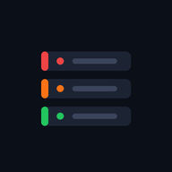
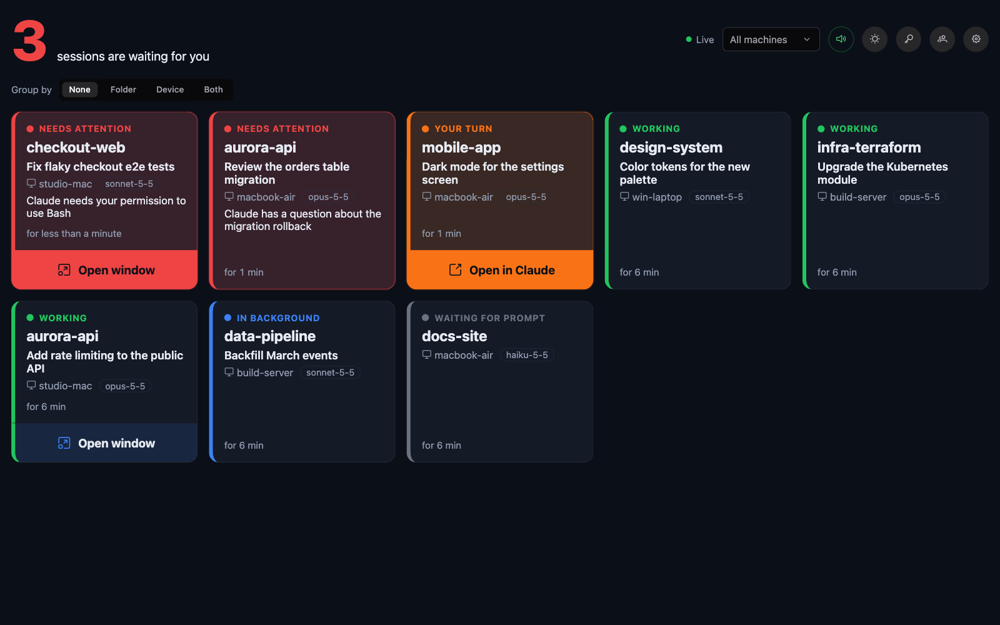
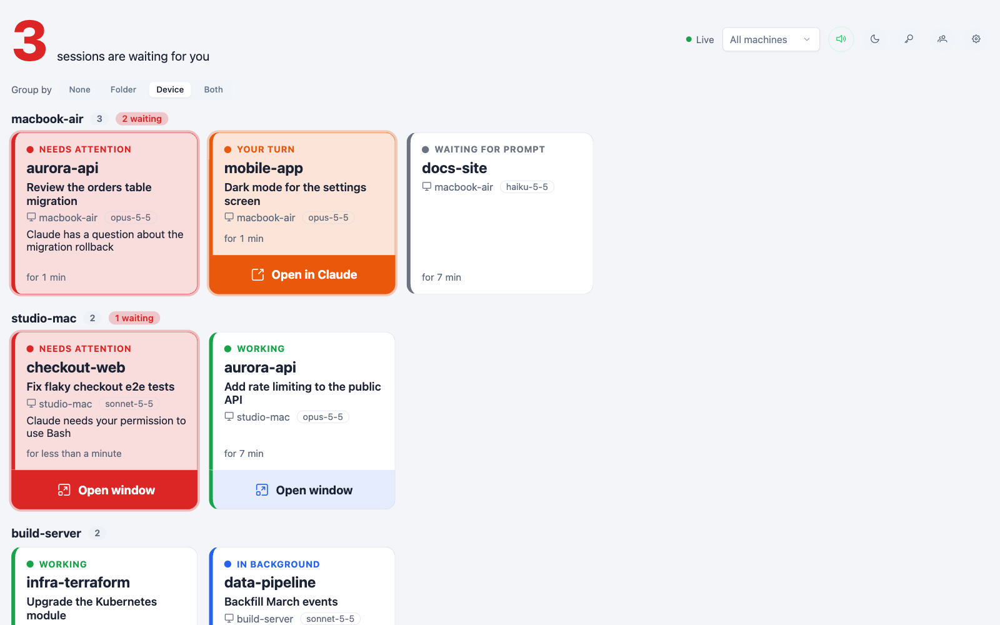
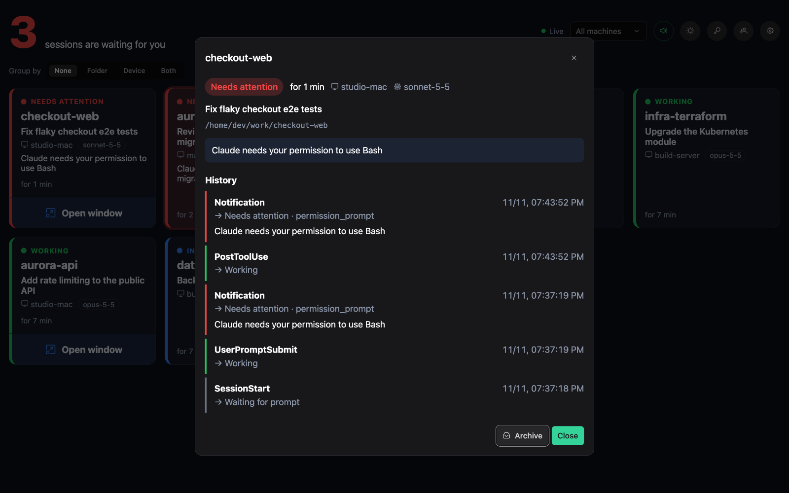
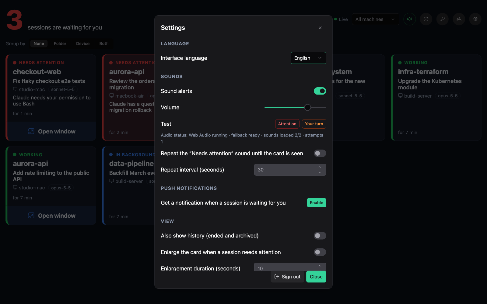
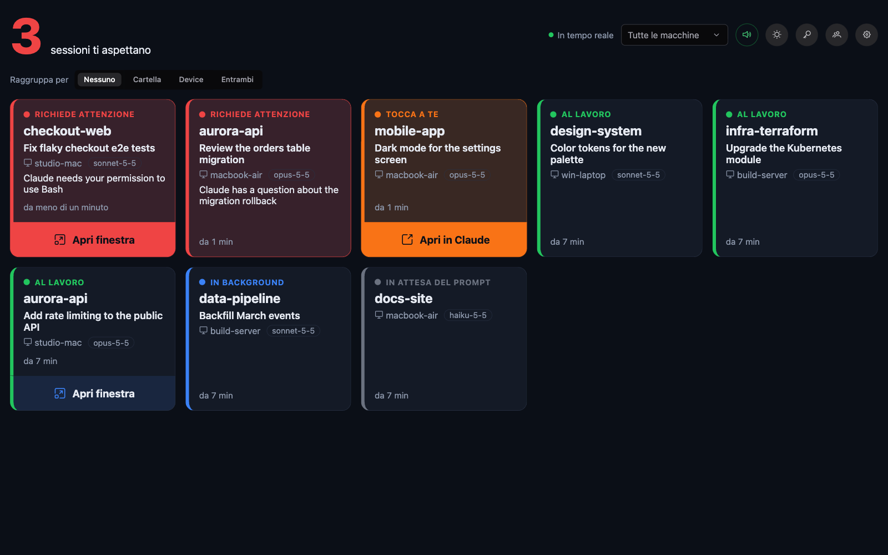
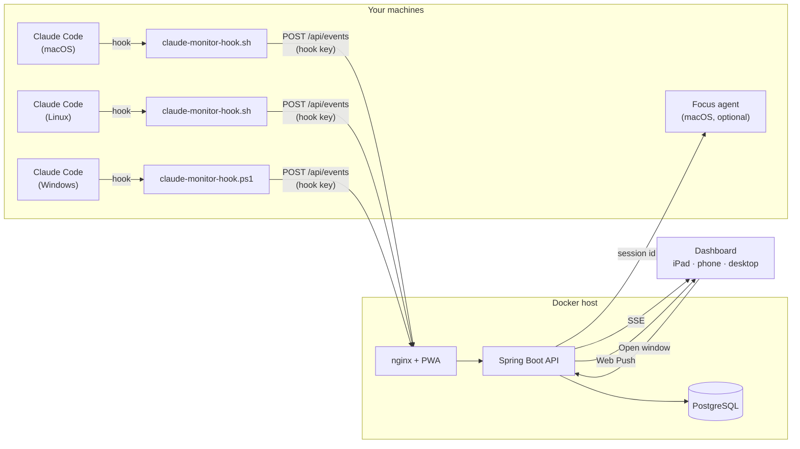

<div align="center">



# Claude Monitor

**A self-hosted, real-time dashboard for all your Claude Code sessions — across every machine.**<br />
Know at a glance which session needs a permission, which one is waiting for your reply and which ones are
still working, with sound alerts and push notifications on your iPad, phone or desktop.

[](https://github.com/sartoriadelcodice/claude-monitor/actions/workflows/ci.yml)
[](LICENSE)
[](backend/pom.xml)
[](frontend/package.json)
[](#install-it-on-ipad-and-iphone)
[](CONTRIBUTING.md)

[Website](https://sartoriadelcodice.github.io/claude-monitor/) ·
[Quick start](#quick-start) ·
[User guide](docs/user-guide.md) ·
[Hooks](hooks/README.md) ·
[Contributing](CONTRIBUTING.md) ·
[🇮🇹 Italiano](README.it.md)



</div>

## Why Claude Monitor?

Running Claude Code in several terminals, on more than one computer, means constantly checking windows to find
out who is stuck on a permission prompt and who has finished and is waiting for you. Claude Monitor collects the
[hook](https://code.claude.com/docs/en/hooks) events of every session and turns them into a single live
board: the sessions that need you come first, glow until you look at them and ring a sound — so you can keep an
iPad on the desk, walk away from the keyboard, and come back exactly when Claude needs you.

## Features

- **Every session, every machine** — one card per Claude Code session with state, folder, session name, machine,
  model and time in the current state, updated live over Server-Sent Events.
- **Attention first** — a counter of the sessions waiting for you; cards sorted by urgency and groupable by folder,
  device or both.
- **Sound alerts and push notifications** — two distinct sounds for *Needs attention* and *Your turn*, optional
  repetition until the card is seen, Web Push even when the app is closed.
- **No false alarms** — sessions that finished answering but still run background tasks or scheduled wake-ups are
  shown as *In background* and stay silent until it is really your turn.
- **Jump to the window** *(macOS, optional)* — an "Open window" button brings the right terminal or the Claude app
  to the front, on the Mac you are actually using; Remote Control sessions supported.
- **Private by design** — the hook strips prompts, answers, tool input and output before sending; the server
  drops them again before saving. Self-hosted: your data never leaves your infrastructure.
- **Multi-user** — each user has their own sessions, hook keys and devices; administrators manage accounts.
- **Installable PWA** — built for iPad and iPhone, works on any modern browser, updates itself, light and dark theme.
- **English and Italian** — the interface follows the browser language or a per-device choice; translations are
  plain JSON files, easy to extend.
- **One-command install of the hooks** — create a key in the dashboard and download a ready-made script for
  macOS, Linux or Windows.

## Screenshots

<table>
  <tr>
    <td width="50%"></td>
    <td width="50%"></td>
  </tr>
  <tr>
    <td align="center">Light theme, cards grouped by device</td>
    <td align="center">Session detail with the event history</td>
  </tr>
  <tr>
    <td width="50%"></td>
    <td width="50%"></td>
  </tr>
  <tr>
    <td align="center">Settings: language, sounds, push, window focus</td>
    <td align="center">Italian interface</td>
  </tr>
</table>

## How it works



1. A small script registered as a Claude Code hook sends each event (session start, prompt, tool use,
   notification, stop…) to the backend, authenticated with a personal **hook key**.
2. The backend maps events to a session state, stores them in PostgreSQL and pushes the change to every open
   dashboard (SSE) and, when the session needs you, to your devices (Web Push).
3. The dashboard plays a sound, highlights the card and, on macOS, can ask the optional agent to bring the session
   window to the front.

### Session states

| State             | Card label         | Meaning                                                                    | Alert        |
| ----------------- | ------------------ | -------------------------------------------------------------------------- | ------------ |
| `NEEDS_ATTENTION` | Needs attention    | Claude is waiting for a permission or an answer to a question              | Sound + push |
| `WAITING_INPUT`   | Your turn          | The response is complete and no work is in progress                        | Sound + push |
| `WORKING`         | Working            | Claude is working                                                          | —            |
| `BACKGROUND`      | In background      | Response complete, but background tasks or scheduled wake-ups will resume it | —          |
| `IDLE`            | Waiting for prompt | Session open, no prompt sent yet                                           | —            |
| `STALE`           | Stale              | No events for longer than `STALE_AFTER` (30 minutes by default)            | —            |
| `ENDED`           | Ended              | Session closed: it leaves the main view and stays in the history          | —            |

The full mapping between hook events and states is in [hooks/README.md](hooks/README.md#events-and-states).

## Quick start

**Requirements:** Docker with Docker Compose, and an HTTPS address for the PWA and push notifications
(see [HTTPS](#https)). On the machines to monitor: Claude Code and `curl` (`jq` recommended).

```bash
git clone https://github.com/sartoriadelcodice/claude-monitor.git
cd claude-monitor
cp .env.example .env
```

1. Edit `.env`: set `DB_PASSWORD`, `ADMIN_PASSWORD` and `JWT_SECRET` (`openssl rand -hex 32` gives a good random
   value). `ADMIN_USERNAME` and `ADMIN_PASSWORD` are used only on first start, to create the initial administrator.
2. Get a free PrimeUI Community License key from <https://primeui.dev/licenses> and put it in `PRIMENG_LICENSE`.
   PrimeNG 22 requires it; without it the dashboard works but shows a notice in a corner.
3. Generate the VAPID keys for push notifications and copy them into `.env`:

   ```bash
   scripts/generate-vapid-keys.sh
   ```

4. Start the stack:

   ```bash
   docker compose up -d --build
   ```

   The dashboard answers on <http://localhost:8088> (`FRONTEND_PORT` changes the port).

5. Sign in, create a **hook key** (key button at the top) and download the installation script for the machine:
   it installs the hook and updates the global Claude Code settings, after backing them up.
   Manual installation is described in [hooks/README.md](hooks/README.md).

Start a new Claude Code session on that machine: its card appears on the dashboard.

> **Just want to look around?** `scripts/demo-events.sh http://localhost:8088 <hook-key> seed` fills the dashboard
> with fake sessions in every state; `live` keeps them changing, to hear the alerts.

### Install it on iPad and iPhone

1. Open the dashboard in Safari through its HTTPS address.
2. Share → **Add to Home Screen**.
3. Open the app from the Home Screen and sign in.
4. Tap **Enable sounds** and **Enable notifications**.

Push notifications on iPadOS and iOS work only from the installed app (16.4 or later).

## Configuration

All settings are environment variables, read from `.env` by Docker Compose
(see [.env.example](.env.example)).

| Variable                      | Default                   | Description                                                        |
| ----------------------------- | ------------------------- | ------------------------------------------------------------------ |
| `DB_PASSWORD`                 | —                         | PostgreSQL password (required)                                     |
| `ADMIN_USERNAME`              | `admin`                   | Initial administrator, created only when no user exists            |
| `ADMIN_PASSWORD`              | —                         | Password of the initial administrator (required)                   |
| `JWT_SECRET`                  | —                         | Secret that signs the login tokens, at least 32 characters (required) |
| `JWT_TTL`                     | `30d`                     | How long a login lasts                                             |
| `STALE_AFTER`                 | `30m`                     | Time without events after which a session becomes *Stale*          |
| `VAPID_PUBLIC_KEY`            | —                         | Web Push public key; push is disabled when empty                   |
| `VAPID_PRIVATE_KEY`           | —                         | Web Push private key                                               |
| `VAPID_SUBJECT`               | `mailto:admin@example.com`| Contact required by the Web Push protocol                          |
| `PRIMENG_LICENSE`             | —                         | PrimeUI license key, embedded in the frontend at build time        |
| `HOOK_TOKEN`                  | —                         | Legacy shared token, imported as a hook key of the administrator  |
| `FRONTEND_PORT`               | `8088`                    | Host port of the dashboard                                         |
| `BACKEND_PORT`                | `8080`                    | Host port of the API, bound to localhost (for frontend development) |
| `CLAUDE_MONITOR_TUNNEL_TOKEN` | —                         | Cloudflare tunnel token for the `tunnel` profile                   |

### HTTPS

PWAs, service workers and push notifications require HTTPS.

- **Production:** put the `frontend` service behind your HTTPS reverse proxy. The proxy must pass the SSE stream of
  `/api/stream` without buffering and with a long timeout.
- **Local testing:** the `tunnel` profile starts [cloudflared](https://developers.cloudflare.com/cloudflare-one/connections/connect-networks/)
  with the `http2` protocol. Create the tunnel in the Cloudflare dashboard (Zero Trust → Networks → Tunnels), add a
  public hostname pointing to `http://frontend:80`, copy the token into `CLAUDE_MONITOR_TUNNEL_TOKEN` and run
  `docker compose --profile tunnel up -d`.

## Usage

The [user guide](docs/user-guide.md) covers the main screen, cards, session detail, connecting machines, sounds,
push notifications, window focus, settings and user management.

## Security and privacy

- Expose the service only over HTTPS, behind a reverse proxy or a tunnel: the frontend port speaks plain HTTP.
- The hook removes prompts, Claude's answers, tool input and output and background task commands before sending
  (with `jq`, or always on Windows); the backend strips them again before saving.
- Passwords are stored with bcrypt, hook keys only as SHA-256 hashes. A hook key can only send events and listen
  for focus requests addressed to its own machine: it can't read sessions or history.
- Window focus is opt-in on every Mac. The agent receives only a session identifier, never commands, never sends
  keystrokes and needs no Accessibility permission; it locks itself on anomalous traffic and only a command typed
  on the Mac unlocks it. A per-user switch in the settings turns focus off for every machine at once.
- Sign-in attempts are rate limited by nginx (10 per minute).

Read [SECURITY.md](SECURITY.md) for the full threat model and to report a vulnerability privately.

## API

| Method and path                                     | Description                                              | Auth        |
| --------------------------------------------------- | -------------------------------------------------------- | ----------- |
| `POST /api/events`                                  | Receives hook events                                     | Hook key    |
| `POST /api/auth/login`                              | Sign in, returns the JWT                                 | —           |
| `GET /api/sessions`                                 | Sessions (`status`, `machine`, `includeHistory`)         | JWT         |
| `GET /api/sessions/{id}/events`                     | Event history of a session                               | JWT         |
| `PATCH /api/sessions/{id}`                          | Mark as seen or archive (`seen`, `archived`)             | JWT         |
| `GET /api/stream`                                   | Real-time updates (SSE)                                  | JWT         |
| `POST /api/sessions/{id}/focus`                     | Brings the session window to the front                   | JWT         |
| `GET /api/focus/agents`                             | Machines with the focus agent connected                  | JWT         |
| `GET`, `PUT /api/focus/settings`                    | The user's focus switch (`enabled`)                      | JWT         |
| `GET /api/agent/stream`                             | Focus requests for a machine's agent (SSE, `machine`)    | Hook key    |
| `POST /api/agent/activity`                          | The agent's answer to an idle-time request               | Hook key    |
| `GET /api/push/public-key`                          | VAPID public key                                         | JWT         |
| `POST`, `DELETE /api/push/subscriptions`            | Registers or removes a device (with its `language`)      | JWT         |
| `GET`, `POST /api/hook-keys`                        | Lists or creates your hook keys                          | JWT         |
| `DELETE /api/hook-keys/{id}`                        | Revokes one of your hook keys                            | JWT         |
| `GET /api/me`, `POST /api/me/password`              | Signed-in user, password change                          | JWT         |
| `GET`, `POST /api/users`, `PATCH /api/users/{id}`   | User management                                          | JWT (admin) |

## Development

```bash
cd backend && mvn test                 # backend tests
cd backend && mvn spring-boot:run      # needs PostgreSQL on localhost:5432 and the variables of .env

cd frontend && npm ci
npm start                              # http://localhost:4200, proxies /api to localhost:8080
npm run i18n:check                     # translations aligned and complete
npm run build                          # production build
```

The frontend needs Node 22.22.3, 24.15 or 26+. Architecture, conventions and the iPadOS constraints to respect are
documented in [CLAUDE.md](CLAUDE.md); the contribution workflow is in [CONTRIBUTING.md](CONTRIBUTING.md).

### Tech stack

Java 21 · Spring Boot 3.5 · Spring Security · PostgreSQL 17 · Flyway · Web Push (VAPID) · Angular 22 (standalone,
signals, zoneless) · PrimeNG 22 · Transloco · Angular service worker · nginx · Docker Compose · Bash and PowerShell
hooks.

### Translations

The interface is available in English and Italian. Translations live in
[`frontend/src/i18n`](frontend/src/i18n) as flat JSON files; push notification texts are in
[`backend/src/main/resources/messages*.properties`](backend/src/main/resources). Adding a language takes a few
files — see [CONTRIBUTING.md](CONTRIBUTING.md#adding-a-language). New translations are very welcome.

## FAQ

<details>
<summary><strong>Does Claude Monitor see my code or my prompts?</strong></summary>

No. The hook sends event metadata (event name, session id, folder name, machine, model, notification type and
message). Prompts, answers, tool input and output are removed on the machine before sending and again on the server.
</details>

<details>
<summary><strong>Does it work with Claude Code on Windows and Linux?</strong></summary>

Yes. The hook exists in Bash (macOS and Linux) and PowerShell (Windows). Only the optional window focus agent is
macOS-specific.
</details>

<details>
<summary><strong>Do I need an Anthropic API key?</strong></summary>

No. Claude Monitor never calls any Anthropic service: it only receives the events of the Claude Code hooks you
install.
</details>

<details>
<summary><strong>Can several people share one installation?</strong></summary>

Yes. Every user sees only their own sessions and gets only their own notifications. Administrators create users;
there is no public sign-up.
</details>

## Contributing

Bug reports, ideas and pull requests are welcome: read [CONTRIBUTING.md](CONTRIBUTING.md) and the
[Code of Conduct](CODE_OF_CONDUCT.md). For security issues follow [SECURITY.md](SECURITY.md) instead of opening a
public issue. Changes are listed in the [changelog](CHANGELOG.md).

## License

Released under the [MIT License](LICENSE). PrimeNG has its own license: every installation uses its own PrimeUI key.

Claude and Claude Code are trademarks of Anthropic, PBC. Claude Monitor is an independent open-source project, not
affiliated with or endorsed by Anthropic.

---

<div align="center">
Made with care by <a href="https://sartoriadelcodice.it">Sartoria del Codice</a>
</div>
